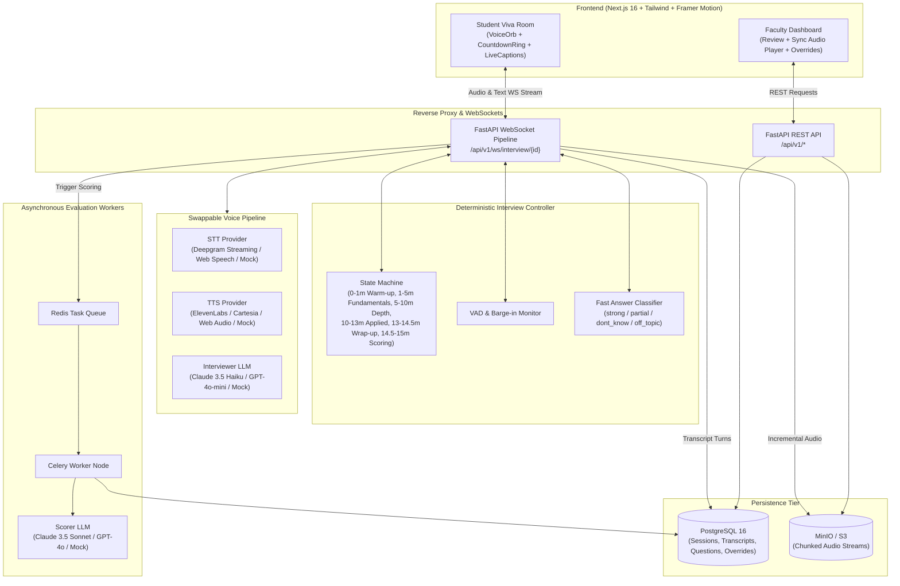

# VivaAI — AI-Powered Voice Technical Viva Examiner

VivaAI is a fair, auditable, and standardized 15-minute AI technical viva platform for university students with an intuitive faculty review dashboard.

---

## Architecture Diagram



---

## Core Principles

- **Fairness:** Every student receives an identical 15-minute timeline, deterministic phase progression, and objective rubric evaluation.
- **Auditability:** Every awarded mark is cited against exact transcript turn IDs (`[turn #2, turn #4]`). Faculty overrides permanently log reviewer name, justification, and timestamp in an immutable audit log.
- **Scalability:** Stateless workers, audio stream chunking to S3/MinIO, and asynchronous Celery/Redis scoring queues.
- **Zero API Key Mock Mode:** Runs out-of-the-box with synthetic speech, classifier, and scoring providers.

---

## 15-Minute Deterministic Schedule

The state machine strictly enforces timing independently of the LLM:
1. **0:00 - 1:00 (Warm-up):** Rapport building, introductory technical self-assessment.
2. **1:00 - 5:00 (Fundamentals):** Core syllabus concept definitions.
3. **5:00 - 10:00 (Depth):** Architectural trade-offs, internal mechanisms, edge cases.
4. **10:00 - 13:00 (Applied Problem):** Practical scenario debugging and design.
5. **13:00 - 14:30 (Wrap-up):** Student reflections and closing remarks.
6. **14:30 - 15:00 (Scoring):** Background async rubric evaluation and session finalization.

### Answer Policy Decision Table

| Classifier Label | Controller Policy Action | Rationale |
|---|---|---|
| **Strong** | `ask_follow_up` | Probes deeper architectural nuance for distinction |
| **Partial** | `give_hint` | Offers 1 guiding hint before moving forward |
| **Don't Know** | `move_on` | Polite advance with **zero negative penalty** |
| **Off-Topic / >90s** | `redirect` | Courteous redirection back to subject matter |

---

## Quickstart (Single Command)

### 1. Environment Setup

Copy `.env.example` to `.env`:
```bash
cp .env.example .env
```

*Note: By default, `MOCK_PROVIDERS=true` is enabled, requiring 0 external API keys.*

### 2. Launch Locally (No Docker Required)

Run the single-command startup script:
```bash
./start_local.sh
```

This launches both the FastAPI backend (`http://localhost:8000`) and the Next.js frontend (`http://localhost:3000`) with automatic SQLite persistence and pre-seeded demonstration data.

### 3. Or Launch with Docker Compose (Production Environment)

```bash
docker compose up --build
```

The services will start automatically:
- **Frontend Web App:** `http://localhost:3000`
- **FastAPI Backend:** `http://localhost:8000`
- **Interactive Swagger Docs:** `http://localhost:8000/docs`
- **PostgreSQL Database:** `localhost:5432`
- **MinIO S3 Console:** `http://localhost:9001` (User: `minioadmin`, Pass: `minioadmin`)

### 3. Demo Credentials

| Role | Identifier | Password | Access Rights |
|---|---|---|---|
| **Faculty** | `priya.sharma@university.edu` | `faculty123` | Setup vivas, view all scores, audit transcripts, commit mark overrides, export CSV |
| **Student** | Student ID: `STU001` | `student123` | Take viva, mic check, review personal submissions |

---

## Database Schema (PostgreSQL + SQLAlchemy)

```sql
-- Users (Students & Faculty)
CREATE TABLE users (
    id UUID PRIMARY KEY,
    name VARCHAR(255) NOT NULL,
    email VARCHAR(255) UNIQUE,
    student_id VARCHAR(64) UNIQUE,
    hashed_password VARCHAR(255) NOT NULL,
    role VARCHAR(32) NOT NULL DEFAULT 'student', -- 'student' | 'faculty' | 'admin'
    created_at TIMESTAMP WITH TIME ZONE DEFAULT NOW()
);

-- Viva Configurations
CREATE TABLE viva_configs (
    id UUID PRIMARY KEY,
    created_by UUID REFERENCES users(id),
    title VARCHAR(255) NOT NULL,
    subject VARCHAR(255) NOT NULL,
    topics JSONB DEFAULT '[]'::jsonb,
    difficulty VARCHAR(32) DEFAULT 'medium',
    total_duration_secs INT DEFAULT 900,
    phase_timings JSONB NOT NULL,
    rubric_weights JSONB NOT NULL,
    is_active BOOLEAN DEFAULT TRUE,
    created_at TIMESTAMP WITH TIME ZONE DEFAULT NOW()
);

-- Question Bank
CREATE TABLE questions (
    id UUID PRIMARY KEY,
    viva_config_id UUID REFERENCES viva_configs(id),
    text TEXT NOT NULL,
    phase VARCHAR(32) NOT NULL,
    topic VARCHAR(128),
    difficulty VARCHAR(32) DEFAULT 'medium',
    expected_keywords JSONB DEFAULT '[]'::jsonb,
    status VARCHAR(32) DEFAULT 'approved', -- 'pending' | 'approved' | 'rejected'
    created_at TIMESTAMP WITH TIME ZONE DEFAULT NOW()
);

-- Viva Sessions
CREATE TABLE viva_sessions (
    id UUID PRIMARY KEY,
    viva_config_id UUID REFERENCES viva_configs(id),
    student_id UUID REFERENCES users(id),
    status VARCHAR(32) NOT NULL DEFAULT 'pending', -- 'pending' | 'in_progress' | 'completed' | 'flagged'
    current_phase VARCHAR(32) DEFAULT 'warm_up',
    elapsed_secs INT DEFAULT 0,
    consent_given BOOLEAN DEFAULT FALSE,
    consent_at TIMESTAMP WITH TIME ZONE,
    started_at TIMESTAMP WITH TIME ZONE,
    ended_at TIMESTAMP WITH TIME ZONE,
    total_score FLOAT,
    score_breakdown JSONB,
    override_score FLOAT,
    override_by UUID REFERENCES users(id),
    override_reason TEXT,
    override_at TIMESTAMP WITH TIME ZONE,
    review_status VARCHAR(32) DEFAULT 'pending', -- 'pending' | 'approved' | 'overridden'
    audio_s3_key VARCHAR(512),
    tab_switch_count INT DEFAULT 0,
    long_silence_count INT DEFAULT 0,
    created_at TIMESTAMP WITH TIME ZONE DEFAULT NOW()
);

-- Timestamped Transcript Turns
CREATE TABLE transcript_turns (
    id UUID PRIMARY KEY,
    session_id UUID REFERENCES viva_sessions(id) ON DELETE CASCADE,
    turn_index INT NOT NULL,
    speaker VARCHAR(32) NOT NULL, -- 'ai' | 'student'
    text TEXT NOT NULL,
    timestamp_secs FLOAT NOT NULL,
    duration_secs FLOAT,
    phase VARCHAR(32),
    question_id UUID REFERENCES questions(id),
    is_variant BOOLEAN DEFAULT FALSE,
    answer_label VARCHAR(32), -- 'strong' | 'partial' | 'dont_know' | 'off_topic'
    stt_confidence FLOAT,
    created_at TIMESTAMP WITH TIME ZONE DEFAULT NOW()
);

-- Score Reports
CREATE TABLE score_reports (
    id UUID PRIMARY KEY,
    session_id UUID UNIQUE REFERENCES viva_sessions(id) ON DELETE CASCADE,
    total_score FLOAT NOT NULL,
    conceptual_score FLOAT NOT NULL,
    conceptual_reason TEXT,
    conceptual_turn_ids JSONB,
    depth_reasoning_score FLOAT NOT NULL,
    depth_reasoning_reason TEXT,
    depth_reasoning_turn_ids JSONB,
    problem_solving_score FLOAT NOT NULL,
    problem_solving_reason TEXT,
    problem_solving_turn_ids JSONB,
    practical_project_score FLOAT NOT NULL,
    practical_project_reason TEXT,
    practical_project_turn_ids JSONB,
    communication_score FLOAT NOT NULL,
    communication_reason TEXT,
    communication_turn_ids JSONB,
    feedback_lines JSONB DEFAULT '[]'::jsonb,
    low_confidence_flag BOOLEAN DEFAULT FALSE,
    low_confidence_reasons JSONB DEFAULT '[]'::jsonb,
    prompt_version VARCHAR(64) NOT NULL,
    created_at TIMESTAMP WITH TIME ZONE DEFAULT NOW()
);

-- Audit Logs
CREATE TABLE audit_logs (
    id UUID PRIMARY KEY,
    session_id UUID REFERENCES viva_sessions(id),
    actor_id UUID REFERENCES users(id),
    action VARCHAR(64) NOT NULL,
    detail JSONB NOT NULL,
    created_at TIMESTAMP WITH TIME ZONE DEFAULT NOW()
);
```

---

## Sample Rubric & Question Bank Configuration

```json
{
  "viva_title": "Distributed Systems & Cloud Computing Viva",
  "subject": "CS 401",
  "difficulty": "medium",
  "rubric_weights": {
    "conceptual": 30,
    "depth_reasoning": 25,
    "problem_solving": 20,
    "practical_project": 15,
    "communication": 10
  },
  "questions": [
    {
      "text": "What is the CAP theorem, and why can a distributed system guarantee at most two of its three properties simultaneously?",
      "phase": "fundamentals",
      "topic": "Distributed Systems",
      "difficulty": "medium"
    },
    {
      "text": "Explain how the Raft consensus algorithm handles leader election split-votes using randomized election timers.",
      "phase": "depth",
      "topic": "Consensus",
      "difficulty": "hard"
    },
    {
      "text": "Given a network partition between two data centers, how would you design vector clocks to reconcile conflicting updates?",
      "phase": "applied",
      "topic": "Replication",
      "difficulty": "hard"
    }
  ]
}
```

---

## Cost Sheet & Economics Template

Estimates based on typical cloud production API rates for a 15-minute technical viva:

### Cost Per 15-Minute Viva

| Component | Provider / Model | Units / Consumption | Unit Rate | Cost per Viva |
|---|---|---|---|---|
| **Speech-to-Text (STT)** | Deepgram Nova-2 | 15 mins audio | $0.0043 / min | **$0.065** |
| **Interviewer LLM** | Claude 3.5 Haiku / GPT-4o-mini | ~3,500 input + 1,200 output tokens | $0.25 / M in, $1.25 / M out | **$0.003** |
| **Text-to-Speech (TTS)** | ElevenLabs / Cartesia | ~1,800 characters spoken | $0.015 / 1k chars | **$0.027** |
| **Scoring LLM** | Claude 3.5 Sonnet / GPT-4o | ~6,000 input + 900 output tokens | $3.00 / M in, $15.00 / M out | **$0.032** |
| **Object Storage & Cloud DB** | AWS S3 / MinIO + RDS PostgreSQL | 15 MB audio recording + DB I/O | Standard tiers | **$0.001** |
| **Total Cost Per Student Viva** | | | | **~$0.128** |

### Cohort Cost for 350 Students

$$\text{Total Cohort Cost} = 350 \times \$0.128 \approx \mathbf{\$44.80}$$

*Comparing against 350 faculty person-hours (~87.5 hours across a 4-professor committee), VivaAI achieves a >98% direct operational savings while maintaining complete faculty review oversight.*

---

## Privacy & Ethical Compliance Note

- **Recording Consent:** Audio streaming commences only after the student grants affirmative, timestamped consent on the pre-check screen (`viva_sessions.consent_given = true`).
- **Student Privacy (FERPA & GDPR):** Audio files are stored with temporary pre-signed S3 URLs and access is restricted strictly to authenticated university faculty.
- **Fairness & Accent Neutrality:** Accent, dialect, and minor grammatical syntax strictly influence the **Communication** dimension (capped at 10% weight). Conceptual, depth, and problem-solving scores are evaluated solely on technical accuracy.
- **Academic Sovereignty:** Automated marks serve as faculty assistance. Reviewing professors retain unilateral override capability with recorded audit rationale.
