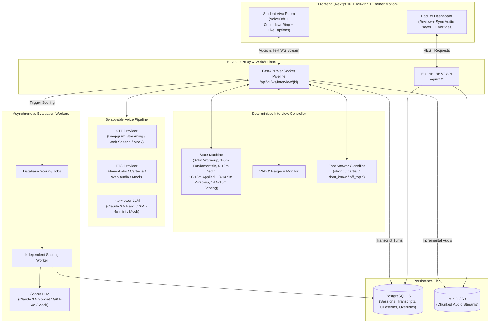
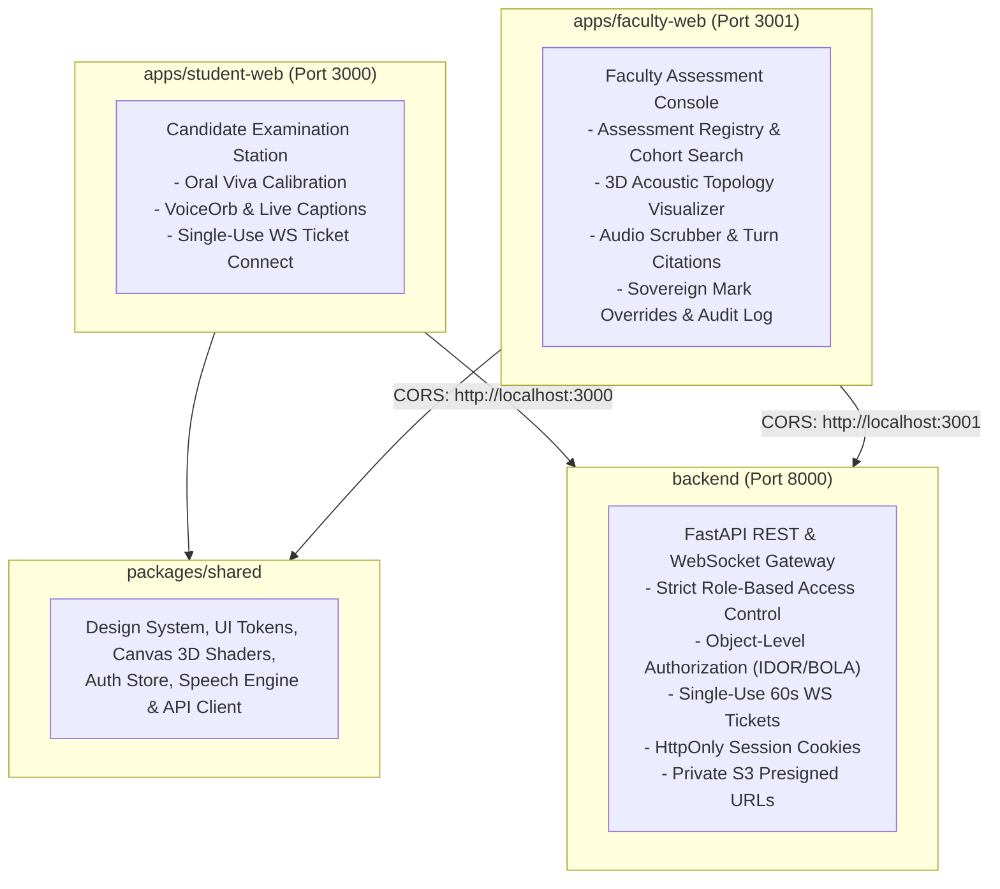

# VivaAI — AI-Powered Voice Technical Viva Examiner

VivaAI is a fair, auditable, and standardized 15-minute AI technical viva platform for university students with an intuitive faculty review dashboard.

---

## Architecture Diagram



---

## Core Principles

- **Fairness:** Every student receives an identical 15-minute timeline, deterministic phase progression, and objective rubric evaluation.
- **Auditability:** Every awarded mark is cited against exact transcript turn IDs (`[turn #2, turn #4]`). Faculty overrides permanently log reviewer name, justification, and timestamp in an immutable audit log.
- **Scalability:** Independent scoring workers claim durable database jobs with renewable leases. Candidate recording fragments are stored immutably in the database; each session is capped at 50 MB. Legacy whole-file uploads can still use S3/MinIO.
- **Zero API Key Mock Mode:** Runs out-of-the-box with synthetic speech, classifier, and scoring providers.

---

## 15-Minute Deterministic Schedule

The state machine strictly enforces timing independently of the LLM:
1. **0:00 - 1:00 (Warm-up):** Rapport building, introductory technical self-assessment.
2. **1:00 - 5:00 (Fundamentals):** Core syllabus concept definitions.
3. **5:00 - 10:00 (Depth):** Architectural trade-offs, internal mechanisms, edge cases.
4. **10:00 - 13:00 (Applied Problem):** Practical scenario debugging and design.
5. **13:00 - 14:30 (Wrap-up):** Student reflections and closing remarks.
6. **14:30 - 15:00 (Scoring):** Background async rubric evaluation and session finalization.

### Answer Policy Decision Table

| Classifier Label | Controller Policy Action | Rationale |
|---|---|---|
| **Strong** | `ask_follow_up` | Probes deeper architectural nuance for distinction |
| **Partial** | `give_hint` | Offers 1 guiding hint before moving forward |
| **Don't Know** | `move_on` | Polite advance with **zero negative penalty** |
| **Off-Topic / >90s** | `redirect` | Courteous redirection back to subject matter |

---

## Multi-Portal Architecture

VivaAI separates candidate and faculty experiences into distinct deployable web applications communicating with a shared hardened FastAPI backend:



---

## Core Security & Reliability Controls

- **Origin Separation:** Student and Faculty applications run as isolated web servers on distinct ports/origins (`http://localhost:3000` and `http://localhost:3001`). CORS uses strict explicit origin whitelists without wildcards.
- **Session & Cookie Security:** Secure, `HttpOnly`, `SameSite=Lax` cookies with CSRF mitigation. Each portal uses a same-origin gateway with a distinct HttpOnly cookie. Access tokens are never returned to browser JavaScript or persisted in browser storage. Server sessions are revocable, and login attempts are rate limited.
- **Single-Use WebSocket Tickets:** WebSocket connections require a short-lived ticket (`POST /api/v1/sessions/{id}/ws-ticket`) valid for 60 seconds. Tokens are never exposed in WebSocket URL query strings. Reconnects and cross-candidate hijacking are strictly blocked (4401/4403).
- **Private Audio Storage:** MinIO/S3 audio buckets are configured with `anonymous set none`. Audio is served exclusively through authenticated presigned URLs (`GET /api/v1/sessions/{id}/audio`).
- **Object-Level Authorization (IDOR/BOLA):** Candidates are strictly forbidden from accessing other candidates' sessions, audio, transcripts, or score reports. Public registration cannot escalate to `faculty` or `admin`.
- **Sovereign Score Overrides & Audit Trail:** Overrides must be within 0–100 and require an explicit justification reason. Every override permanently logs reviewer identity, previous score, new score, reason, and UTC timestamp in an immutable `AuditLog`.
- **Production Fail-Safe Startup:** In `APP_ENV=production`, the application refuses to boot if `SECRET_KEY` equals `change_me_in_prod` or is under 32 characters, if SQLite fallback is attempted, or if demo persona tokens are used.
- **Liveness & Readiness Probes:** Kubernetes-compatible health endpoints at `/health/live` (process liveness) and `/health/ready` (tests live database and storage connectivity).

---

## Local Development (Single Command)

### 1. Launch All Local Services

Run the startup script:
```bash
./start_local.sh
```

This starts:
- **Student Examination Web App:** `http://localhost:3000`
- **Faculty Assessment Web App:** `http://localhost:3001`
- **Shared FastAPI Backend:** `http://localhost:8000` (API Docs: `http://localhost:8000/api/docs`)

### 2. Available NPM Monorepo Commands

```bash
# Development servers
npm run dev:student    # Starts student portal on port 3000
npm run dev:faculty    # Starts faculty portal on port 3001

# Production builds
npm run build:student  # Builds student web app
npm run build:faculty  # Builds faculty web app
npm run build          # Builds both web applications

# Verification & Quality checks
npm run lint           # Lints both student and faculty applications
npm run test:backend   # Runs full backend pytest regression suite
```

### 3. Demonstration Personas

| Role | Identifier / Email | Password | Access Rights |
|---|---|---|---|
| **Faculty** | `priya.sharma@university.edu` | `faculty123` | Setup vivas, view all scores, audit transcripts, commit mark overrides, export CSV |
| **Student** | Student ID: `STU001` | `student123` | Take viva, mic check, review personal submissions |

---

## Production Deployment (Docker Compose)

A hardened production Compose configuration is provided in `docker-compose.prod.yml`:

```bash
# 1. Set production environment variables
cp .env.example .env.production
# Edit .env.production with strong SECRET_KEY (>= 32 chars) and production DB credentials

# 2. Launch production stack
docker compose -f docker-compose.prod.yml up --build -d
```

### Production Hardening Highlights:
- **Unexposed Internal Ports:** PostgreSQL (5432), Redis (6379), and MinIO (9000/9001) ports are not exposed on the host interface.
- **Pinned Container Images:** All base images use immutable tags (e.g., `postgres:16.4-alpine3.20`, `redis:7.4.0-alpine3.20`, `node:20-alpine`).
- **Non-Root Execution:** Frontend containers run under an unprivileged `nextjs` system user (`UID 1001`).
- **Multi-Worker Uvicorn:** Application runs with 4 production workers (`uvicorn ... --workers 4`), with `--reload` disabled.
- **Private Audio Storage:** Storage bucket initializes with `mc anonymous set none` to prevent unauthorized downloads.

---

## Database Schema (PostgreSQL + SQLAlchemy)

```sql
-- Users (Students & Faculty)
CREATE TABLE users (
    id UUID PRIMARY KEY,
    name VARCHAR(255) NOT NULL,
    email VARCHAR(255) UNIQUE,
    student_id VARCHAR(64) UNIQUE,
    hashed_password VARCHAR(255) NOT NULL,
    role VARCHAR(32) NOT NULL DEFAULT 'student', -- 'student' | 'faculty' | 'admin'
    created_at TIMESTAMP WITH TIME ZONE DEFAULT NOW()
);

-- Viva Configurations
CREATE TABLE viva_configs (
    id UUID PRIMARY KEY,
    created_by UUID REFERENCES users(id),
    title VARCHAR(255) NOT NULL,
    subject VARCHAR(255) NOT NULL,
    topics JSONB DEFAULT '[]'::jsonb,
    difficulty VARCHAR(32) DEFAULT 'medium',
    total_duration_secs INT DEFAULT 900,
    phase_timings JSONB NOT NULL,
    rubric_weights JSONB NOT NULL,
    is_active BOOLEAN DEFAULT TRUE,
    created_at TIMESTAMP WITH TIME ZONE DEFAULT NOW()
);

-- Question Bank
CREATE TABLE questions (
    id UUID PRIMARY KEY,
    viva_config_id UUID REFERENCES viva_configs(id),
    text TEXT NOT NULL,
    phase VARCHAR(32) NOT NULL,
    topic VARCHAR(128),
    difficulty VARCHAR(32) DEFAULT 'medium',
    expected_keywords JSONB DEFAULT '[]'::jsonb,
    status VARCHAR(32) DEFAULT 'approved', -- 'pending' | 'approved' | 'rejected'
    created_at TIMESTAMP WITH TIME ZONE DEFAULT NOW()
);

-- Viva Sessions
CREATE TABLE viva_sessions (
    id UUID PRIMARY KEY,
    viva_config_id UUID REFERENCES viva_configs(id),
    student_id UUID REFERENCES users(id),
    status VARCHAR(32) NOT NULL DEFAULT 'pending', -- 'pending' | 'in_progress' | 'completed' | 'flagged'
    current_phase VARCHAR(32) DEFAULT 'warm_up',
    elapsed_secs INT DEFAULT 0,
    consent_given BOOLEAN DEFAULT FALSE,
    consent_at TIMESTAMP WITH TIME ZONE,
    started_at TIMESTAMP WITH TIME ZONE,
    ended_at TIMESTAMP WITH TIME ZONE,
    total_score FLOAT,
    score_breakdown JSONB,
    override_score FLOAT,
    override_by UUID REFERENCES users(id),
    override_reason TEXT,
    override_at TIMESTAMP WITH TIME ZONE,
    review_status VARCHAR(32) DEFAULT 'pending', -- 'pending' | 'approved' | 'overridden'
    audio_s3_key VARCHAR(512),
    tab_switch_count INT DEFAULT 0,
    long_silence_count INT DEFAULT 0,
    created_at TIMESTAMP WITH TIME ZONE DEFAULT NOW()
);

-- Timestamped Transcript Turns
CREATE TABLE transcript_turns (
    id UUID PRIMARY KEY,
    session_id UUID REFERENCES viva_sessions(id) ON DELETE CASCADE,
    turn_index INT NOT NULL,
    speaker VARCHAR(32) NOT NULL, -- 'ai' | 'student'
    text TEXT NOT NULL,
    timestamp_secs FLOAT NOT NULL,
    duration_secs FLOAT,
    phase VARCHAR(32),
    question_id UUID REFERENCES questions(id),
    is_variant BOOLEAN DEFAULT FALSE,
    answer_label VARCHAR(32), -- 'strong' | 'partial' | 'dont_know' | 'off_topic'
    stt_confidence FLOAT,
    created_at TIMESTAMP WITH TIME ZONE DEFAULT NOW()
);

-- Score Reports
CREATE TABLE score_reports (
    id UUID PRIMARY KEY,
    session_id UUID UNIQUE REFERENCES viva_sessions(id) ON DELETE CASCADE,
    total_score FLOAT NOT NULL,
    conceptual_score FLOAT NOT NULL,
    conceptual_reason TEXT,
    conceptual_turn_ids JSONB,
    depth_reasoning_score FLOAT NOT NULL,
    depth_reasoning_reason TEXT,
    depth_reasoning_turn_ids JSONB,
    problem_solving_score FLOAT NOT NULL,
    problem_solving_reason TEXT,
    problem_solving_turn_ids JSONB,
    practical_project_score FLOAT NOT NULL,
    practical_project_reason TEXT,
    practical_project_turn_ids JSONB,
    communication_score FLOAT NOT NULL,
    communication_reason TEXT,
    communication_turn_ids JSONB,
    feedback_lines JSONB DEFAULT '[]'::jsonb,
    low_confidence_flag BOOLEAN DEFAULT FALSE,
    low_confidence_reasons JSONB DEFAULT '[]'::jsonb,
    prompt_version VARCHAR(64) NOT NULL,
    created_at TIMESTAMP WITH TIME ZONE DEFAULT NOW()
);

-- Audit Logs
CREATE TABLE audit_logs (
    id UUID PRIMARY KEY,
    session_id UUID REFERENCES viva_sessions(id),
    actor_id UUID REFERENCES users(id),
    action VARCHAR(64) NOT NULL,
    detail JSONB NOT NULL,
    created_at TIMESTAMP WITH TIME ZONE DEFAULT NOW()
);
```

---

## Sample Rubric & Question Bank Configuration

```json
{
  "viva_title": "Distributed Systems & Cloud Computing Viva",
  "subject": "CS 401",
  "difficulty": "medium",
  "rubric_weights": {
    "conceptual": 30,
    "depth_reasoning": 25,
    "problem_solving": 20,
    "practical_project": 15,
    "communication": 10
  },
  "questions": [
    {
      "text": "What is the CAP theorem, and why can a distributed system guarantee at most two of its three properties simultaneously?",
      "phase": "fundamentals",
      "topic": "Distributed Systems",
      "difficulty": "medium"
    },
    {
      "text": "Explain how the Raft consensus algorithm handles leader election split-votes using randomized election timers.",
      "phase": "depth",
      "topic": "Consensus",
      "difficulty": "hard"
    },
    {
      "text": "Given a network partition between two data centers, how would you design vector clocks to reconcile conflicting updates?",
      "phase": "applied",
      "topic": "Replication",
      "difficulty": "hard"
    }
  ]
}
```

---

## Cost Sheet & Economics Template

Estimates based on typical cloud production API rates for a 15-minute technical viva:

### Cost Per 15-Minute Viva

| Component | Provider / Model | Units / Consumption | Unit Rate | Cost per Viva |
|---|---|---|---|---|
| **Speech-to-Text (STT)** | Deepgram Nova-2 | 15 mins audio | $0.0043 / min | **$0.065** |
| **Interviewer LLM** | Claude 3.5 Haiku / GPT-4o-mini | ~3,500 input + 1,200 output tokens | $0.25 / M in, $1.25 / M out | **$0.003** |
| **Text-to-Speech (TTS)** | ElevenLabs / Cartesia | ~1,800 characters spoken | $0.015 / 1k chars | **$0.027** |
| **Scoring LLM** | Claude 3.5 Sonnet / GPT-4o | ~6,000 input + 900 output tokens | $3.00 / M in, $15.00 / M out | **$0.032** |
| **Object Storage & Cloud DB** | AWS S3 / MinIO + RDS PostgreSQL | 15 MB audio recording + DB I/O | Standard tiers | **$0.001** |
| **Total Cost Per Student Viva** | | | | **~$0.128** |

### Cohort Cost for 350 Students

$$\text{Total Cohort Cost} = 350 \times \$0.128 \approx \mathbf{\$44.80}$$

*Comparing against 350 faculty person-hours (~87.5 hours across a 4-professor committee), VivaAI achieves a >98% direct operational savings while maintaining complete faculty review oversight.*

---

## Privacy & Ethical Compliance Note

- **Recording Consent:** Audio streaming commences only after the student grants affirmative, timestamped consent on the pre-check screen (`viva_sessions.consent_given = true`).
- **Student Privacy (FERPA & GDPR):** Audio files require authenticated session access; candidates can access their own recordings and authorized faculty can review sessions. Institutional retention and privacy policies must be configured before rollout.
- **Fairness & Accent Neutrality:** Grading prompts assess technical evidence and understandable meaning, without penalizing accent, dialect, pace or language mixing. This policy still needs validation with representative human recordings and independent faculty labels.
- **Academic Sovereignty:** Automated marks serve as faculty assistance. Reviewing professors retain unilateral override capability with recorded audit rationale.


## Candidate experience audit October 2026

The active applications are `apps/student-web`, `apps/faculty-web`, and `packages/shared`, backed by `backend`. Existing uncommitted work was preserved. The fixes below address verified defects; production operation still requires the validation and follow-up work described below.

### Implemented fixes

| Area | Verified defect | Result |
| --- | --- | --- |
| Recording privacy | The streaming endpoint allowed anonymous access and public caching. | Playback requires authentication and session ownership. Recordings use private caching, and the faculty player fetches them with API credentials. |
| Speech credentials | Provider credentials were embedded in server and browser source. | Credentials are read from the backend environment. Browser speech uses authenticated endpoints and device speech. Previously exposed keys require rotation. |
| Connection security | Tickets could be replayed and used as API access tokens. | Ticket redemption is atomic through a unique audit record; API access tokens require the correct purpose. |
| Recovery | Reconnecting reset time, question history, and turn indices. | Rejoining restores persisted progress and the outstanding question. A saved answer awaiting an examiner response is handled during recovery; earlier recording captures are retained. |
| Answer delivery | A dropped connection could leave the candidate unsure whether an answer was stored. | Answers carry stable IDs, receive a server acknowledgement after storage, and can be resent without duplicate grading. Unsent text is saved in the current browser tab. |
| Concurrent tabs | Multiple connections could drive the same exam. | A connection lease permits one active owner. Production workers share the lease through Redis; local development uses an in-process lease. |
| Completion | The client could show success before storage, and scoring could be dispatched repeatedly. | Completion follows the server confirmation and atomically queues scoring. Recording fragments sync continuously, and final-upload errors remain visible and retryable. |
| Timing | Faculty duration choices still used a fixed 15-minute schedule. | Default phases scale to the configured duration. Timings must be contiguous and rubric weights must sum to 100. The server also enforces a hard deadline around the live session. |
| Grading integrity | Provider errors silently returned fabricated fallback marks. | Failed evaluations preserve the transcript and flag the session for review without creating a score. Mock grading is blocked in production and identified in candidate practice feedback. |
| Readiness | Failed speaker tests could pass, repeated microphone tests leaked streams, and demo bypasses were always visible. | Audio failures remain failures, old microphone resources are released, demo bypasses require an explicit flag, and candidates can choose typed answers. |
| Candidate navigation | Candidates lacked a session history and feedback screen. | `/sessions` provides resume links, assessment dimensions, feedback, and automatic checking while feedback is pending. |
| Validation | Malformed faculty IDs, question files, or unbounded uploads could produce server errors or consume excessive resources. | Routes validate IDs, assessment settings, pagination, question-file structure and size, and recording type and size. |
| Development checks | Shared components were excluded from lint and tests used the development database. | Root lint includes both portals and the shared package. Backend tests use a temporary database and recording directory. |
| Deployment | Missing dependencies and migrations prevented a clean backend setup; build contexts included private files. | Dependencies include SQLite and PDF support, an initial Alembic migration creates the schema, async migrations run correctly, Docker contexts exclude secrets and recordings, and frontend builds accept explicit public endpoint arguments. |
| Local startup | The startup script forcibly killed processes occupying application ports. | Startup reports occupied ports, preserves those processes, checks backend readiness, and cleans up only its own children. |

### Validation

Run `npm run lint`, `npm run build`, and `npm run test:backend` from the repository root. The backend suite passes 132 tests as of the speech-review update. Backend regression coverage includes authorization, ticket replay, duplicate answers, session leases, custom schedules, grading failure, and lifecycle boundaries. Migration upgrade and schema comparison were checked on a disposable SQLite database; PostgreSQL migration SQL was generated with each enum created once. Browser checks covered demo-account sign-in, readiness, and the candidate history screen at a mobile-sized viewport.

Live cloud speech quality, Safari/Firefox microphone behavior, the Redis connection lease under worker failure, a deployed PostgreSQL migration, and the complete production Compose stack still require environment-specific integration testing. These checks are necessary before claiming production readiness.

### Recording continuity and interruption

The browser writes 250 ms microphone fragments to IndexedDB before upload and deletes each fragment only after an authenticated server acknowledgement. Fragment IDs and capture sequence numbers make retries idempotent. Each page lifetime receives its own capture ID, so reloading cannot overwrite a previous recording. Offline fragments resume uploading after reconnect or the next visit to that interview. Completing an interview waits for the final recorder event and pending uploads; a failed upload remains retryable.

The database stores immutable fragments with a 50 MB per-session limit. Authenticated playback reconstructs each capture using FFmpeg, then places it on the interview timeline with silence across recording gaps. Browser/device shutdown can still interrupt the final fragment before IndexedDB commits it; the application does not claim that audio was stored until it is acknowledged. Candidate microphone audio is recorded; examiner speech remains in the transcript and is not mixed into the microphone recording.

A separate socket reader handles deliberate interruption while speech synthesis is running. It cancels the speech task without cancelling the interview, and speech IDs prevent late audio frames from restarting interrupted playback. Voice activity alone does not interrupt a question.

### Durable scoring jobs

Interview completion and a unique scoring job are committed in the same database transaction. Workers atomically claim jobs, renew their leases, retry provider failures, and recover expired claims after a worker stops. A claim token fences off stale workers so they cannot publish a second grade. After three failed attempts the job requires faculty review. `GET /api/v1/sessions/{id}/scoring` exposes queued, processing, completed, and failed states; authorized faculty can request a retry with `POST /api/v1/sessions/{id}/scoring/retry`.

Local development runs a queue consumer in the API process. Production Compose sets `SCORING_WORKER_ENABLED=false` on the API and runs `python -m app.workers.scoring_worker` as an independent service. Jobs remain in the database when either process restarts. Completed legacy sessions without a report or durable job are reconciled into the queue. Redis/Celery remain available for existing question-generation tasks and Redis still owns the production connection lease; scoring no longer falls back to disposable API tasks.

### Browser authentication

Student and faculty REST requests use their own `/api/v1` gateway. The gateway forwards authentication on the server, strips access tokens from login responses, rejects cross-origin writes, and sets a host-only HttpOnly cookie for its portal. Portals have different cookie names even when both run on localhost. Zustand holds only verified user identity in memory and restores it through `/auth/me`; old stored credentials are removed. Logout revokes the database session before clearing the cookie. Existing sockets check session validity at least every ten seconds. Production requests reject old access tokens without a revocable session ID.

Set `API_INTERNAL_URL` to the backend address reachable from the portal server (`http://backend:8000` in Compose). `NEXT_PUBLIC_WS_URL` remains the externally reachable WebSocket address. Configure HTTPS at the reverse proxy for secure production cookies.

### Reproducible browser verification

Install development test dependencies with `.venv/bin/pip install -r backend/requirements-dev.txt`, then run `npm run test:e2e`. The runner uses Google Chrome or the executable in `PLAYWRIGHT_CHROME`, a disposable database, ports 13000/13001/18000, and synthetic microphone audio. It migrates an empty database, signs in through the UI, checks audio readiness, submits an answer, simulates an offline period, reloads the interview, verifies recording fragments across captures, completes the interview, restarts the API, and starts the independent scoring worker. It then checks candidate feedback, the faculty transcript and recording player, CSRF rejection, logout, and a mobile typed interview without microphone permission. Mock providers are explicit; the test does not use a real candidate microphone or paid cloud services.

Screenshots, browser traces, logs, and a machine-readable result are written under `test-results/candidate-flow/`. This directory is ignored by Git. The test shuts down only the processes it starts and does not reuse a development database.

Run `npm run test:e2e:real` to use the AI and voice credentials configured in `.env` (environment variables take precedence). This mode makes paid provider calls with synthetic candidate data. It verifies real text and JSON model responses, synthesizes spoken candidate input through the selected cloud TTS provider, and submits that encoded speech through the authenticated interview WebSocket to Deepgram transcription. The browser also captures the synthetic speech as its microphone source. The run checks live speech interruption, offline/reload recording continuity, durable scoring after an API restart, visible model-generated feedback, faculty playback, logout, and mobile typed submission during examiner speech. It asserts the configured scoring model and rejects mock feedback. Results, provider names, a synthetic score report, screenshots and traces go in `test-results/candidate-flow-real/`.

The browser voice-input UI uses Web Speech Recognition; the real-provider test sends its synthetic spoken answer through the backend audio-answer path rather than automating Chrome's external recognition service. This validates the configured Deepgram integration, but does not establish real-microphone recognition quality or human-perceived audio latency. Both flows finish early through the candidate's submission controls rather than waiting through the full exam timer.

Verified on 2026-10-20 with Groq (`qwen/qwen3.8-27b`), ElevenLabs and Deepgram: desktop and mobile flows passed, two recording captures survived reload, scoring completed after the API restart, and the browser reported no uncaught errors. The backend regression suite passed 116 tests. These checks used disposable test data; the production database and deployment were not exercised.

`npm run test:e2e:full` runs a visible, isolated Chrome interview against the real providers for the normal 900-second schedule, without clock acceleration or early submission. It feeds cloud-synthesized spoken audio through Chrome's microphone interface, observes native SpeechRecognition events, and submits only the text populated by that recognizer. It checks all five question phases, natural completion, the full microphone archive, missing recording fragments, real scoring, and visible feedback. Results and 30-second progress observations are saved in `test-results/candidate-full-duration/`. The schedule reserves its final 30 seconds for scoring, so candidate recording normally ends near 870 seconds. This is an automated spoken-audio test; it does not measure a human speaker's microphone, accent, room noise, or transcription accuracy across voices.

Chrome recognition uses the selected microphone's live audio track, with a separate unfiltered input for recognition and the existing processed input for recording. Utterance recognition restarts automatically and accumulates final text. Repeated silence errors stop after three attempts; network and capture failures preserve the draft and offer retry or typing. Late recognition results cannot refill an already submitted answer. A missing voice-activity end event cannot defer a phase indefinitely: the controller enforces the 90-second live answer limit.

ElevenLabs authentication, quota and rate-limit rejections temporarily route new speech to Deepgram for five minutes across voice instances. Existing cached ElevenLabs speech remains usable. Provider setup reports the effective speech provider as well as the configured one. Exhausted provider quota requires an account-side change; the application does not purchase credits automatically.

The full-duration run on 2026-10-20 passed in 919.7 seconds, with all five question phases, 15 native Chrome speech submissions, an unbroken 870-second recording, no browser or speech-service errors, and real scoring completed on its first attempt. ElevenLabs quota ran out during testing; real Deepgram voice fallback succeeded. The scripted responses deliberately repeat a fixed sample instead of answering the changing questions, so the resulting academic score is not an acceptance criterion. The real scorer flagged that synthetic session for faculty review. At that stage, the backend suite passed 120 tests.

The standalone native Chrome probe recognized the complete spoken sample but misheard technical words, including “mutexes.” Candidate transcripts remain editable, with explicit guidance to review technical terms before submission. These tests verify delivery and recovery, not a transcription-accuracy benchmark or human microphone quality.

Real providers cannot silently select mock STT, TTS or LLM responses. Explicit TTS selection is honored even when several keys exist. The configured ElevenLabs provider may fall back to real Deepgram speech; unavailable speech is reported as a failure when neither service works. Typed answers remain available without STT credentials. Explicit answer submission interrupts examiner speech instead of silently dropping the answer. Scoring distinguishes examiner text from student text.

### Deployment and remaining environment checks

Apply migrations through `d39f2a80461b` (`alembic upgrade head`) before running this version against a migrated production database. Migration `d39f2a80461b` adds nullable answer-evidence metadata; its predecessor `c9284c5b75e8` adds the durable infrastructure described here. It adds recording fragments, scoring jobs, revocable sessions, and authentication rate-limit counters. For existing databases created outside Alembic, compare the schema and back it up before choosing a baseline stamp. The initial migration targets an empty database; do not blindly apply it over an existing schema.

The local development database at `backend/vivaai.db` was backed up under `backend/data/backups/`, compared against model metadata with no differences, and registered at `c9284c5b75e8` on 2026-10-20. Its new tables already existed from development startup, so registration used an Alembic stamp followed by upgrade/check. No completed sessions required scoring-job backfill. Commands explicitly targeted SQLite because the configured PostgreSQL Docker hostname is unreachable outside Compose. This does not migrate a remote or production database.

Rotate the previously exposed speech-provider keys in the provider accounts. Source cleanup cannot revoke them or remove old bundles. Production PostgreSQL, Redis failover, deployment latency, and browser-specific audio behavior require validation in the intended deployment environment. The legacy `frontend` tree uses the cookie gateway compatibility path, but consolidating its duplicate UI into the two active portals remains a maintenance task.


### Speech review, evidence-aware grading and adaptive questions

The active student portal now offers **Record with enhanced speech** alongside
native Chrome dictation and typed answers. It records one answer (up to 90
seconds), transcribes it through authenticated Deepgram access, highlights words
with recognition confidence below 0.8, and lets the candidate correct the text
before **Confirm & Submit Answer**. Nothing from the draft endpoint is submitted
or graded automatically. The candidate's text and signed transcription receipt
survive a tab reload. Failed transcription can retry the saved clip while the
page remains open; the durable interview recording provides separate recovery.
Typing is paused while enhanced recording/transcription is active so a late
transcript cannot overwrite newly typed text.

Deepgram receives vocabulary from faculty-approved question keywords and syllabus
topics, using the model-appropriate [keywords/keyterm API](https://developers.deepgram.com/reference/speech-to-text/listen-pre-recorded).
No automatic spelling replacement invents technical answers. Speech requests
require session ownership, consent, an active interview, a supported format,
a 2 MB limit, and a per-candidate request limit. Signed receipts bind provider
confidence, original words and the answered question to the session; they are
not authentication tokens. Expired receipts restore the candidate's answer for
text review and resubmission. The transcript preserves original recognition,
candidate corrections, word confidence, and classifier confidence. Faculty can
inspect corrected recognition alongside authenticated recording playback.

Scorer prompt `v2-evidence` permits only non-empty student turns as citations.
Missing explanations, missing dimension evidence, fewer than three answers,
unconfirmed low-confidence speech, or frequently uncertain answer interpretation
send the durable job to `review_required`. This is a terminal review outcome,
not a provider retry. The session and reasons remain available to faculty,
without publishing invented numeric marks or a PDF score report. Candidate-
confirmed corrections supersede the original recognition confidence. Faculty
can assign an audited overall mark, which is then visible in candidate feedback.
A verified incorrect answer and missing assessment evidence are treated
separately. Provider errors still use bounded durable retries.

Question selection starts at the faculty's configured difficulty, adjusts one
level after two confident responses, prefers fresh topics, and avoids near-
duplicate questions. Reconnection rebuilds question and answer context. Generated
questions include syllabus, difficulty and recent question history; repeat
outputs are retried, with a rotating fallback on provider failure. Uncertain
interpretations ask for clarification before advancing, instead of confidently
praising or penalizing an ambiguous answer. Cloud answers captured across a
phase change retain their earlier question association.

The local SQLite database was backed up to
`backend/data/backups/pre-answer-evidence-20261020.db`, upgraded to
`d39f2a80461b`, and checked against model metadata. This does not migrate a
production database. Both portal builds, root lint, 132 backend tests and the
real-provider recovery browser flow passed during this update. See
`test-results/candidate-flow-real/` for reviewable speech, recording, recovery,
faculty playback and mobile typed-answer artifacts. Full-duration validation is
recorded separately under `test-results/candidate-full-duration/`.

`tests/quality/evaluate.py` provides offline word-error-rate and grade-agreement
measurement using genuine reference transcripts and optional human faculty
scores. See `tests/quality/README.md` for the dataset contract. No human speech
accuracy, fairness, or academic-validity result is claimed: a representative,
consented, faculty-labelled benchmark remains necessary. Production PostgreSQL,
Redis failover, deployment latency, Safari and Firefox remain environment checks.


Final validation of this update: the unaccelerated full run completed in 916.4
seconds, with 15 native Chrome-recognized submissions, all question phases,
2,905 complete recording fragments and an 870.2-second decoded answer recording
(the remaining scheduled time is reserved for evaluation). All 15 submissions
had unique saved IDs and persisted classifications. There were no browser or
speech-service errors. The real scorer requested faculty review for repetitive,
off-topic synthetic answers, with no unsupported numeric report published.
Artifacts: `test-results/candidate-full-duration/result.json` and the synthetic
SQLite snapshot in the same directory (local, ignored, permissions 0600).

Real-provider quality probes also accepted a concise correct definition, rejected
attempts to instruct the grader to award full marks, and produced a supported
score for a separate synthetic technical transcript. These are contract checks,
not evidence of agreement with human faculty. The additional positive probe
found a model response containing prose in a numeric score field. Scoring now
validates field types and permits one bounded schema-repair attempt before the
existing durable retries; it never converts prose into invented marks. Both
numeric-report publication and terminal faculty review have regression coverage.
See `test-results/quality-provider-probe.json`.

Automatic browser speech submissions are marked as unreviewed and require
transcription verification before a numeric grade is published. Manual candidate
confirmation remains the default. Faculty-assigned results update an open
candidate feedback view automatically; the UI identifies them as faculty
assessment. Clearing a draft also clears its speech receipt, and a damaged
saved draft cannot crash the interview page.

The final default and real-provider browser reruns both passed, including automatic candidate feedback updates after faculty assessment. Consolidated results are in `test-results/interview-improvements-validation.json`.
