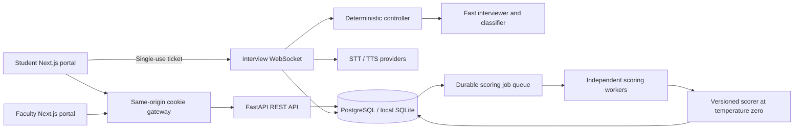

# VivaAI design and validation boundaries

## Product

A faculty member creates a technical viva with topics, difficulty and an approved
question bank. A student signs in, reads the rules, checks audio and gives
recording consent. The examiner runs a fixed, configurable timeline; the default
is warm-up 0–60s, fundamentals 60–300s, depth 300–600s, applied 600–780s, wrap-up
780–870s, and background scoring 870–900s. New configurations and legacy live sessions cannot exceed 900 seconds. Phase
intervals remain configurable through the API. The controller owns time and policy;
LLM text cannot extend the exam. The student can review/correct speech drafts,
clear an unsubmitted answer, reconnect, or use typed answers.

## Architecture

The portals share UI tokens, auth/gateway code and transcript playback. REST
credentials remain in separate HttpOnly portal cookies. WebSocket tickets are
short-lived and single-use. Authorization checks session ownership for students;
faculty can review cohort records. Browser Web Audio mixes the candidate microphone and actually played AI media.
Fragments are uploaded idempotently and stored incrementally in the database.
Typed sessions record AI playback without microphone access, and old microphone
captures stay labelled candidate-only. Legacy whole-file storage can use
S3/MinIO. Production requires PostgreSQL; SQLite is a local preview/testing mode.

## Interview policy and audit

Depth prioritizes the strongest topic established by confident earlier answer
labels and reconstructs that preference from question references on rejoin.
Strong answers receive a deeper probe; partial answers receive one nudge;
explicit uncertainty moves on; off-topic answers are redirected. Candidate
answers are persisted and acknowledged before provider work. Approved question
IDs or generated-variant markers remain attached to transcript turns. Rejoining
restores the recorded time and question; interrupted uploads remain on-device
until synchronized. A renewable database lease prevents competing live agents.

The scorer grades five dimensions on 0–5, weighted 30/25/20/15/10 into 0–100.
Dimension reasons and each of the 3–5 feedback lines cite candidate transcript
indices. The server validates every feedback citation and stores its relationship
to the line. APIs resolve indices to real UUIDs, timestamps and candidate text
only after session authorization. Student and faculty links open the relevant
transcript; exported reports contain clickable links to included excerpts.
Missing/invalid feedback evidence holds a new automated grade for faculty review.
Old reports keep explicit “evidence not recorded” states; no links are invented.

Faculty overrides always determine the effective mark and require a reason.
Reviewer identity, previous/new mark and time are audited. Missing or unreliable
transcripts do not become fabricated grades. Prompt versions are stored.

## Reliability and providers

Live interviewer/classifier and offline scorer use independently configurable
fast and strong model names. Topic-change transitions are neutral and deterministic
to avoid an extra LLM call and accidental answer disclosure.
SDK retries are bounded; terminal provider failures preserve answers and require
review rather than silently grading with mocks. ElevenLabs quota/auth rejection
uses the configured real TTS fallback and a cooldown. Deepgram live speech forwards fragments immediately and returns interim/final
editable drafts on a separate authenticated socket. Complete-container STT is
retained as a saved-clip retry. MP3 MediaSource playback starts before the last
provider chunk where supported; other formats retain container playback. Candidate confirmation
and review time can materially affect perceived latency and must be measured.

## Visual interaction and accessibility

Both portals use one light/dark token system and a user-visible theme control.
The homepage's Three.js preview has explicit listen/think/speak controls, pointer
interaction, lazy loading, visibility-based suspension, reduced-motion and WebGL
fallbacks. It is labelled as a preview and does not imply microphone capture.
Live assessment screens prioritize timing, the current question and answer.

## What is established and what is pending

Backend, migration and browser tests cover evidence integrity, authorization,
recording recovery, grading jobs, theme consistency and the 3D preview controls.
The raw load result in `docs/validation/transport-load.json` is a local synthetic
transport/SQLite/mock-provider benchmark. It is not a real speech capacity result.
Human grading agreement, accented/Hinglish WER, five full demo recordings,
real-provider latency, current operating costs, institutional retention approval and
production capacity still require the evidence described in the Test Report.

## Faculty tools and submission design

The faculty calibration page accepts independent marks in CSV, compares them with
original AI scores, computes MAE/bias/correlation and records reviewer provenance
without changing marks. Mock results remain development-only. Optional code
snippets are stored with the candidate explanation and never executed.

Retention holds require faculty authorization/reason. The operator purge is
policy-gated, disabled by default and plans before explicit apply. Reviewed,
ended, old, unheld records without pending scoring are rechecked under lock;
external copies/backups remain governed by the institution. See docs/PRIVACY.md.

The reproducible three-page PDF is output/pdf/vivaai-design.pdf; its pages were
rendered and visually checked. Source builder: scripts/build_design_pdf.py.
